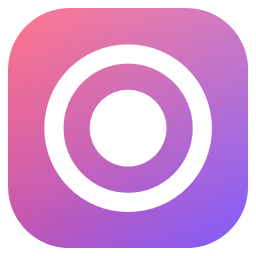
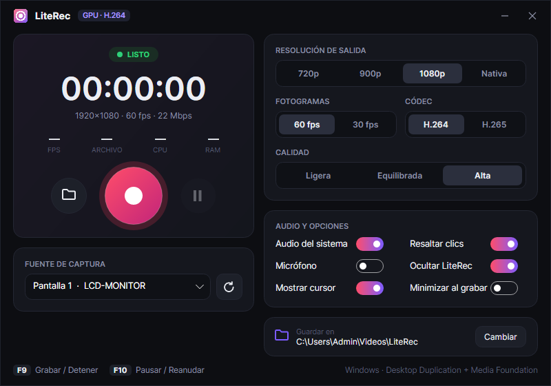

<p align="center">
  
</p>

<h1 align="center">LiteRec</h1>

<p align="center">
  <b>Grabador de pantalla ultraligero para Windows</b><br>
  60 fps · captura y codificación por GPU · casi sin CPU ni RAM
</p>

<p align="center">
  
  
  
</p>

<p align="center">
  
</p>

---

## ✨ Características

- 🎥 **60 fps constantes** a 720p, 900p, 1080p o resolución nativa
- ⚡ **Captura por GPU**: Desktop Duplication (pantalla) y Windows.Graphics.Capture (ventanas)
- 🧠 **Codificación por hardware** H.264 / H.265: Intel Quick Sync, NVIDIA NVENC o AMD AMF
- 🔊 Audio del sistema y/o micrófono (AAC)
- 🖱️ Cursor opcional y resaltado de clics
- 🙈 La ventana de LiteRec se oculta en la grabación
- ⌨️ Atajos globales: **F9** grabar/detener · **F10** pausar/reanudar
- 📊 Estadísticas en vivo: fps, tamaño del archivo, CPU y RAM
- 💾 Recuerda tus ajustes entre sesiones

## 🚀 Rendimiento

En una laptop con Intel HD 520, grabando 1280×720 a 60 fps:

| CPU media | RAM | Video |
|-----------|-----|-------|
| ~9 %      | ~150 MB | 60.00 fps, ~6 Mbps |

**Cómo lo consigue:** la imagen se captura, se escala y se codifica dentro de la GPU, así que los fotogramas nunca pasan por la RAM ni por código administrado. No hay vista previa en vivo, la interfaz se refresca una vez por segundo y la memoria se libera al terminar cada grabación.

## 📥 Descargar

Ve a **[Releases](../../releases)**, descarga `LiteRec-win-x64.zip`, descomprímelo y abre `LiteRec.exe`.

Requisitos:
- Windows 10 (versión 2004 o superior) u 11, de 64 bits
- [Runtime de escritorio de .NET 10](https://dotnet.microsoft.com/download/dotnet/10.0) (*.NET Desktop Runtime*)
- [Visual C++ Redistributable 2015-2022 x64](https://aka.ms/vs/17/release/vc_redist.x64.exe)

Los videos se guardan en `Videos\LiteRec`. Puedes cambiar la carpeta desde la app.

## 🛠️ Compilar desde el código

```bash
git clone https://github.com/<tu-usuario>/LiteRec.git
cd LiteRec
dotnet build -c Release
```

El ejecutable queda en `src/LiteRec/bin/x64/Release/net10.0-windows/win-x64/LiteRec.exe`.

Para generar la carpeta de distribución:

```bash
dotnet publish src/LiteRec -c Release -o App
```

### Estructura

```
LiteRec/
├─ src/LiteRec/
│  ├─ Core/
│  │  ├─ RecordingEngine.cs   # motor de captura y codificación
│  │  ├─ AppSettings.cs       # ajustes guardados en %AppData%\LiteRec
│  │  └─ NativeMethods.cs     # atajos globales y liberación de memoria
│  ├─ Assets/                 # logo e icono
│  ├─ App.xaml                # tema oscuro y estilos
│  └─ MainWindow.xaml         # interfaz
├─ docs/                      # imágenes del README
└─ LiteRec.sln
```

### Modo de prueba

```bash
LiteRec.exe --selftest 6 C:\ruta\prueba.mp4
```

Graba 6 segundos de la pantalla principal y escribe los fps, la CPU y la RAM en `prueba.mp4.log.txt`.

## 🤝 Contribuir

Los *issues* y *pull requests* son bienvenidos. Algunas ideas:
- Webcam superpuesta
- Grabar solo una región de la pantalla
- Icono en la bandeja del sistema
- Capturas de pantalla con un atajo

## 📄 Licencia

[MIT](LICENSE). Usa [ScreenRecorderLib](https://github.com/sskodje/ScreenRecorderLib) (MIT); ver [THIRD-PARTY-NOTICES](THIRD-PARTY-NOTICES.md).
